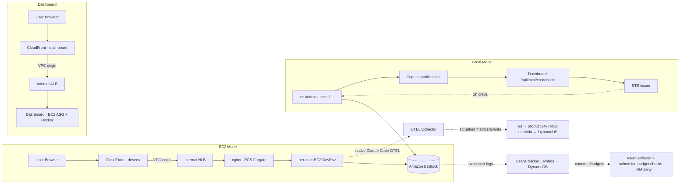
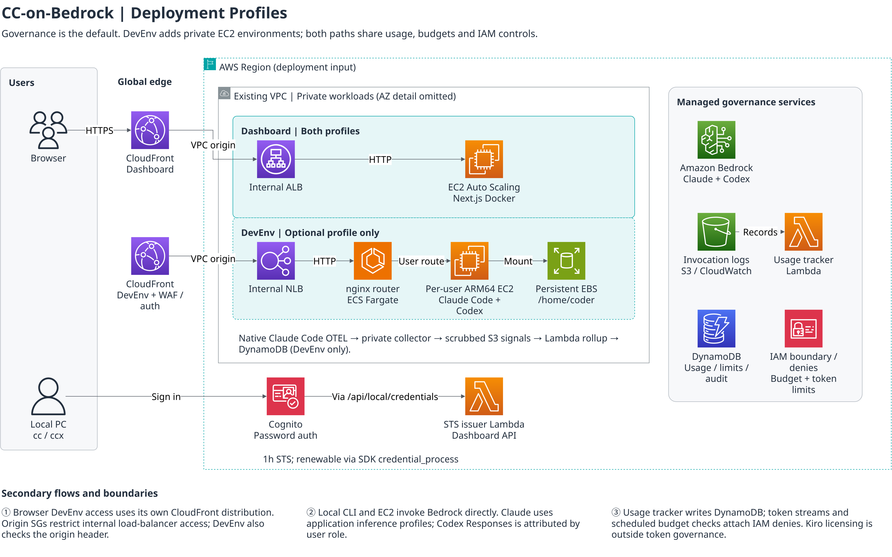

# CC-on-Bedrock — Architecture (SSOT)

> **SINGLE SOURCE OF TRUTH for the CURRENT architecture. Read this FIRST.**
> ADRs in `docs/decisions/` are the *decision log* (why); the decision baseline is
> `docs/decisions/BASELINE.md`. Anything under `docs/decisions/archive/` or `docs/history/`
> is **historical / superseded — NOT current**.
> Last reconciled: 2026-10-26 (Terraform-only; governance/devenv profiles; BYO VPC; dashboard on EC2 ASG; native Claude Code OTEL; Codex on Bedrock).

## What this is
멀티유저 Claude Code 개발환경 플랫폼 on AWS Bedrock. 사용자는 per-user EC2 DevEnv(브라우저 IDE)
또는 로컬 PC에서 Bedrock을 호출하고, 사용량·예산·IAM 권한이 중앙에서 거버넌스된다.

## Access paths

The self-service portal distinguishes unavailable status from an absent
environment. Failed refreshes retain the last verified state and expose retry or
sign-in recovery. Start/stop controls require verified status; `STOPPING` remains
visible until the status API confirms completion. Provisioning progress requires
a terminal event, and closing its view does not cancel the underlying start.
Custom-route version conflicts preserve local edits until the user explicitly
reloads the server configuration.





> **Deployment profiles:** `deployment_mode = "governance"` (default) deploys only the Dashboard and Local Mode paths. The EC2 Mode path, the OTEL collector and the EC2 idle/hibernate schedules exist only with `deployment_mode = "devenv"`. With the mode unset, `terraform plan` fails if DevEnv security groups already exist, so an older tfvars cannot silently destroy DevEnvs.
> 2 CloudFront distributions (ADR-003): devenv(→NLB→nginx, devenv profile only) and dashboard(→ALB→EC2 ASG), 분리.
> 두 LB 모두 **internal**(private subnet)이며 CloudFront **VPC origin**으로만 도달한다. LB SG ingress는 `CloudFront-VPCOrigins-Service-SG`만 허용하고, nginx는 NLB SG만 허용한다. 공인 IP·internet-facing LB 없음.
> **Network (BYO VPC):** 스택은 VPC·서브넷·NAT·IGW·게이트웨이 엔드포인트를 만들지 않는다. `vpc_id`와 subnet ID 목록을 tfvars로 받고(ADR-015), VPC에 없는 interface endpoint만 `interface_endpoint_services`로 추가한다. Route 53 공용 zone(`domain_name`)은 다른 프로젝트와 공유하므로 data source로 조회하고 레코드만 추가한다.
> Dashboard runs the real Next.js standalone container from Terraform-managed ECR. `dashboard_image_tag`
> is injected into the launch template and pinned to the ASG for deterministic instance refresh.
> `NEXTAUTH_SECRET` is fetched from SSM at boot, DevEnv edge auth strips NextAuth cookies before
> forwarding to per-user origins, and dashboard ECR is bootstrapped before image push on fresh deploys.

## Canonical decisions (the 9 pillars)

1. **Tools on Bedrock.** Claude Code and the **OpenAI Codex CLI** both run on Bedrock under the same
   governance (ADR-014). Codex uses only the `amazon-bedrock-runtime` provider (bedrock-runtime
   Responses API, `global.openai.*` profiles; never bedrock-mantle) with the same per-user role
   credentials (IMDS on EC2, `credential_process` in Local Mode — `cc-bedrock-local codex` / `ccx`).
   DevEnv ships governed defaults in `/etc/codex/config.toml` (system layer). Kiro is installed by
   default but uses IAM Identity Center licensing — **not** part of Cognito/Bedrock usage governance.
2. **Two access paths.** EC2 Mode (CloudFront→NLB→nginx ECS→EC2) + Local Mode (`cc-bedrock-local`
   → Cognito public client → Dashboard `/api/local/credentials` → STS issuer; STS returns 1h creds,
   the CLI calls Bedrock). Terraform `deployment_mode` selects the profile: `governance` (default)
   deploys the dashboard, governance layer and local installer without EC2 Mode; `devenv` adds
   EC2 Mode (ADR-006 amendment 2026-10-23).
3. **Code-activity OTEL (native).** EC2 DevEnv enables native Claude Code OpenTelemetry
   (`claude_code.*` metrics + `tool_result`/`tool_decision` events). The collector exports
   both signals to S3 (logs DLP-scrubbed to skill/agent/tool counts, no content); a rollup
   Lambda aggregates per-user (`enduser.id` email) daily KPIs into DynamoDB
   (`PROD#`/`SKILL#`/`AGENT#`/`TOOL#`/`ACTIVE#`). Bedrock token/cost stays authoritative in
   the 005 usage pipeline. (ADR-009; P1 rewrite 2026-06-26 — supersedes the custom emitter.)
   Codex productivity telemetry is not rolled up yet (follow-up); Codex cost/tokens are fully
   covered by pillar 4.
4. **Usage metering.** Bedrock **Application Inference Profiles** + **Invocation Logs** → **DynamoDB**
   (not CloudWatch AWS/Bedrock account-wide metrics). Codex Responses calls land in the same
   invocation log (`operation = "Responses"`) and are attributed by the per-user role identity
   (the Responses API rejects application inference profiles). Rows carry `tool`
   (`claude-code`|`codex`|`other`); cost uses explicit per-model rates incl. cache read/write
   (ADR-014). Audit: CloudTrail management events → `audit-logger` → `cc-prompt-audit` with
   `client_tool` from the userAgent.
5. **Shared credential model.** EC2 and Local attribute usage through the **same Application Inference
   Profile**; they do **not** share one literal IAM role (share policy shape, permission boundary,
   tags, inference-profile attribution). Exception: Codex (ADR-014) cannot use application
   inference profiles (the Responses API rejects them), so Codex usage is attributed by the
   per-user role identity in the invocation log.
6. **DevEnv compute & storage.** Per-user EC2; OS = **Ubuntu** or **Amazon Linux 2023**. **2-volume
   model (ADR-002):** replaceable OS root EBS +
   **persistent data EBS** for `/home/coder` (GP3, `DeleteOnTermination=false`, subdomain-tagged,
   reattached across rebuild/OS-switch). Idle instances Stop/Hibernate and resume with state intact.
   **Implementation discrepancy:** ADR-002 specifies `DeleteOnTermination=true` for the OS root,
   but `ec2-clients.ts` and the Terraform launch template currently set it to `false`.
   Recovery must inventory both retained volumes; this documentation sync does not change
   deletion behavior. Persistent user data must remain protected.
7. **Self-service IAM.** UI requests for extra IAM permissions require **admin approval**, bounded by
   a permission boundary authored in Terraform (boundary X = account-scoped allowance,
   operational baseline and a 63-pattern `DenyEscalation` floor). The source contains all
   representative canonical floor entries checked by `check-policyset-boundary.py`;
   Terraform plan/show validation against the request allowlist remains a follow-up
   (ADR-007). This source check does not prove deployed-policy parity.
8. **Budget enforcement.** Per-department and per-user budgets/limits ($ + normalized token);
   **EventBridge** drives IAM deny-policy updates. Per-user USD budgets are three independent
   caps — daily / weekly / monthly (UTC windows; token limits use KST) — and any one exceeded
   blocks (ADR-008 amendment 2026-10-18). Claude Code and Codex spend count against the
   same budgets (no per-tool budget); the deny covers the Responses API.
9. **Path/port routing.** code-server reached by path (`?folder=`), stays on port **8080** (reserved);
   extra user ports mapped path→port via nginx. Custom ports must not use 8080/well-known.
   The dashboard does **not** directly probe devenv:8080 (the devenv SG admits only the nginx SG, so a
   direct probe always times out); portal `healthStatus` is derived from EC2 lifecycle —
   `running` + non-blank `privateIp` ⇒ HEALTHY, else UNKNOWN (ADR-012, optimistic trade-off).

## IaC
- **Terraform is the only IaC.** CDK/CloudFormation removed (ADR-001). Lambda handlers in `lambda/`
  (Terraform packages them). Policies incl. permission boundary authored in Terraform (ADR-007).

## Key paths
```text
terraform/          Terraform root and modules (canonical IaC)
lambda/             Lambda source
shared/nextjs-app/  Dashboard (Next.js)
tools/              cc-bedrock-local.sh, cc-otel-code-metrics.sh
docker/nginx/       Shared nginx router image
docs/decisions/     BASELINE.md + active ADRs · archive/ = historical
```

## Hard rules (invariants)
- No new CDK/CloudFormation deployment paths. Lambda source stays in `lambda/`.
- Do not use one literal IAM role for both EC2 and Local mode.
- Do not extend chained STS credentials beyond one hour — use `credential_process` renewal.
- DevEnv data lives on the persistent data EBS, not the OS root (a Terminate must not destroy it).
- Keep port 8080 reserved for code-server.
- Keep Kiro out of Cognito and Bedrock token-limit enforcement.
- Never grant `bedrock-mantle:*`; Codex stays on bedrock-runtime (ADR-014).

## Where decisions live
- **Current truth:** this file + `docs/decisions/BASELINE.md`.
- **Why (log):** `docs/decisions/ADR-*.md`; superseded → `docs/decisions/archive/` (not current).
