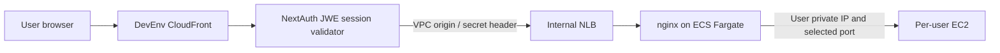

# DevEnv Port Routing Guide

This guide applies to `deployment_mode="devenv"`. The dashboard supplies the
actual URL using the configured domain and DevEnv subdomain. There is no public
IP or direct internet-facing listener on a user's EC2 instance.

## Access and authentication



The viewer-request edge validator checks the NextAuth session and user scope.
It strips NextAuth cookies before forwarding and injects `X-Auth-User`.
The internal origin SG chain and custom secret header protect ingress.
Cognito OAuth/HMAC-cookie and public CloudFront prefix-list diagrams are
historical, not the current DevEnv authentication contract.

## Default routes and reserved IDE paths

| Route | Default port | Purpose |
|---|---:|---|
| `/?folder=/home/coder` | 8080 | code-server IDE |
| `/` | 3000 | Seeded frontend route |
| `/api` | 8000 | Seeded API route |

code-server remains on reserved port **8080**. Its internal paths, including
`/_static`, `/stable-*`, `/vscode-remote-resource`, `/out`, `/webview`, `/healthz`
and `/manifest.json`, cannot be replaced by a user custom route. Nginx's
`?folder=` handling preserves IDE access independently of the frontend route.
Frontend/API defaults are seeded into `customRoutes`; they are not the only
exposable ports. A user can change/remove those routes through the supported UI.

Use the dashboard's **Open IDE** action or a configured URL of this form:

```text
https://<user-subdomain>.<dev-subdomain>.<domain>/?folder=/home/coder
```

## Add a custom route

Start the environment first, then edit Ports/custom routes in the user portal.
Each route has `path`, `port` and a short `label`. The current validator permits:

- Up to five routes; no duplicate paths or ports, and at most one root `/`.
- Ports 1024–65535, excluding 8080. The broad range is reachable only from the
  nginx SG, not from arbitrary internet clients.
- `/` or lowercase segment paths such as `/preview` and `/api/v1`, up to 64
  characters, with no trailing slash, repeated slash or reserved path.
- Labels of 1–32 characters. Internal health/IDE paths remain reserved.

`GET/PUT /api/user/custom-routes` is scoped to the authenticated user's subdomain.
The client sends the version it loaded; a stale version returns 409. Keep local
edits until the user explicitly reloads the server configuration. A save can be
pending while the instance is stopped or the routing-table mirror is delayed.
The generator validates again before emitting nginx config and reports route
status; a successful API write alone does not prove the service is listening.

## Start a service and check routing

A process bound only to `127.0.0.1` cannot be reached by the private nginx router.
Bind the development service to the instance interface as required, while
keeping the platform SG restrictions:

```bash
# Frontend on its seeded route
npx vite --port 3000 --host 0.0.0.0
# API on its seeded route
uvicorn main:app --host 0.0.0.0 --port 8000
# Another app: configure /preview -> 5173 in the portal first
npx vite --port 5173 --host 0.0.0.0
```

These are application examples, not platform provisioning commands. The custom
path's nginx handling is defined in `lambda/nginx-config-gen.py`; account for
its path-prefix behavior and your app's base path/WebSocket configuration.
Browser requests still enter through authenticated CloudFront.

For a failure, verify environment state/private IP, route status/version, the
process listener, generated nginx config and origin/instance SG chain. Missing
services can return the platform's no-service response; opening public SG
ports or bypassing CloudFront is not a routing fix.

## Code pointers

- `shared/nextjs-app/src/lib/validation.ts`: route limits and reserved paths.
- `shared/nextjs-app/src/app/api/user/custom-routes/route.ts`: user scope and CAS.
- `shared/nextjs-app/src/lib/ec2-clients.ts`: authoritative routes and registration.
- `lambda/nginx-config-gen.py`: validation, upstreams, path routing and status.
- `lambda/devenv-session-validator/index.js`: edge session validation/cookie stripping.
- `terraform/modules/ec2-devenv/main.tf`: nginx-only custom-port ingress.

Related: [ADR-003](decisions/ADR-003-access-topology-routing.md),
[ADR-015](decisions/ADR-015-byo-vpc-internal-origins.md),
[instance recovery](runbooks/instance-recovery.md).
