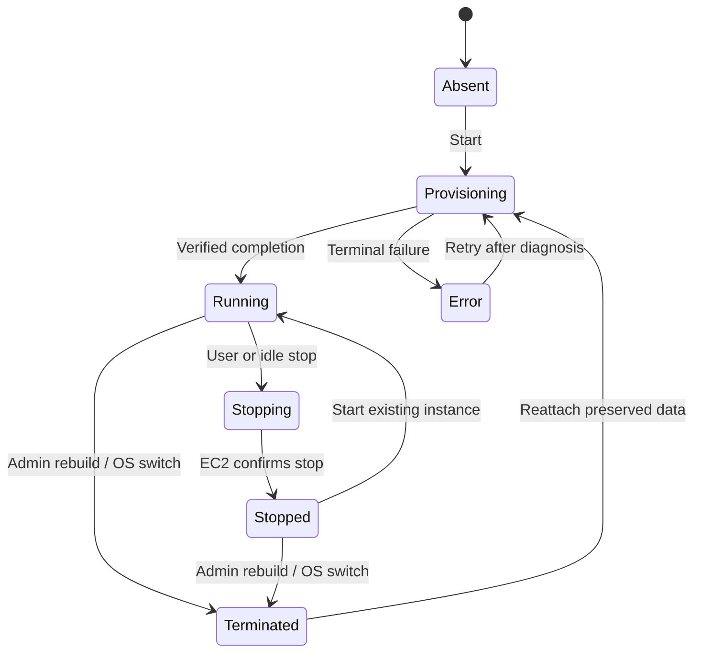

# EC2 DevEnv Instance Lifecycle

This is the `devenv` profile's per-user ARM64 EC2 lifecycle. Governance does not
create DevEnvs; its user lifecycle APIs return the profile's unavailable response.
Read [ADR-002](decisions/ADR-002-devenv-compute-storage.md) and
[architecture](architecture.md) for the current storage contract.

## States and user controls



The portal retains the last verified status when refresh fails, exposes retry
or sign-in recovery, and requires verified state before start/stop. `STOPPING`
remains visible until EC2 status confirms completion. Closing a provisioning
view does not cancel the underlying start; a terminal event is required before
claiming success.

## Persistent data and replaceable OS

New environments have two encrypted GP3 EBS volumes. `/home/coder` (workspace,
Claude state, dotfiles and user tools) lives on the persistent data volume with
`DeleteOnTermination=false`. `dataVolumeId`/`dataVolumeAz` in the instance record
are authoritative. Canonical `cc:subdomain`, `cc:role=data` and `cc:project` tags
permit fail-closed rediscovery when records are unavailable.

The root contains OS/system packages. ADR-002 intends an ephemeral root, but
current runtime and Terraform mappings also use `DeleteOnTermination=false`.
Record that discrepancy when inventorying retained roots. A rebuild does not
promise retention of every package installed outside `/home/coder`, even though
ordinary stop/start preserves the attached root and data volumes.

The mount/migration units verify the expected device/volume and use filesystem
label `CCDATA`; do not identify a Nitro EBS volume solely by `/dev/sdf`. Legacy
root-only users need inspection/migration before assuming user data is separate.

## Start, stop and rebuild

| Operation | Implemented flow |
|---|---|
| Start existing | Read the user's instance record, upsert IAM/runtime configuration, start or return the existing instance, register routing |
| First launch | Select the user's OS AMI from SSM; create root + born-attached data volume, tag/record data identity and start code-server |
| Recreate with data | Resolve the stored volume or unique tag match, choose a private subnet in that AZ, launch and attach the preserved data |
| Stop/hibernate | Deregister the route, stop the instance; hibernation falls back to regular stop if needed |
| Ordinary terminate / OS switch | Preserve data and use the next launch to reattach it |
| Complete account deletion | Separate data deletion path; verify user/volume ownership and retention policy before invoking it |

Duplicate volume candidates, mismatched attachment or no usable subnet in the
data volume's AZ require operator resolution. Do not create another empty
volume or discard the authoritative ID to conceal a failed reattach.

`POST /api/user/container` owns self-service start/stop; admin operations use
`/api/containers`. Routing and instance records are separate. Runtime-created
per-user roles/instance profiles are updated at start under the Terraform-owned
boundary; source tags and data identity must agree.

Stopping avoids instance compute charges but does not eliminate EBS/storage or
other platform charges. It is not a snapshot or backup. Snapshot/restore
functions and legacy `cc-user-volumes` references remain in runtime source,
but current Terraform does not declare that table. These references do not prove
table availability or that ordinary stop/start requires snapshot reconstruction.
The separate persistent-data guarantee does not replace backup policy.

## Idle and hibernation

The optional profile wires `ec2-idle-stop` and lifecycle schedules through
Terraform. The idle handler considers configured CPU/network/usage/keep-alive
signals and emits diagnostic counters. Inspect current Lambda environment and
source for thresholds instead of copying fixed demo values.

Hibernation depends on the feature flag and instance/volume capability. The
runtime can fall back to regular stop. Persistent volumes remain attached during
normal stop/hibernate; the user resumes through the supported dashboard flow.

## Build or replace AMIs

After infrastructure prerequisites exist, and before the first user launch:

```bash
bash scripts/build-ami.sh ubuntu
# Or for Amazon Linux 2023:
bash scripts/build-ami.sh al2023
```

The helper builds on temporary ARM64 EC2, installs supported tools and data
mount/migration units, registers an AMI, and stores its ID under
`/cc-on-bedrock/devenv/ami-id/{os}` (with a legacy alias). It needs the dashboard
EC2 IAM role, DevEnv open SG and a discoverable private subnet. Its subnet lookup
still relies on legacy Name tags; BYO VPC tfvars alone do not configure that
helper. Follow [deployment](deployment-guide.md) for ordering and limitations.

An AMI change does not mutate an existing user's root on ordinary start. Use the
supported rebuild/OS-switch operation and verify reattached `/home/coder` data
before returning the environment to the user.

## Code pointers and recovery

| Concern | Source |
|---|---|
| Lifecycle / IAM upsert / routing | `shared/nextjs-app/src/lib/ec2-clients.ts` |
| Data identity, AZ, migration/mount | `shared/nextjs-app/src/lib/data-volume.ts`, `data-volume-userdata.ts`, `data-volume-ssm.ts` |
| Portal confirmed-state behavior | `shared/nextjs-app/CLAUDE.md` |
| Launch template and DLP SGs | `terraform/modules/ec2-devenv/` |
| Idle handling / schedules | `lambda/ec2-idle-stop.py`, `terraform/modules/usage-tracking/` |
| AMI helper | `scripts/build-ami.sh` |

Use [instance recovery](runbooks/instance-recovery.md) for stale routes, telemetry
migration and retained-volume diagnostics; use
[destroy/redeploy](runbooks/full-teardown-redeploy.md) for platform teardown.
Legacy ADR numbers map through [ADR-MAPPING](history/ADR-MAPPING.md); the current
storage decision is 002 and Terraform consolidation is 001.
