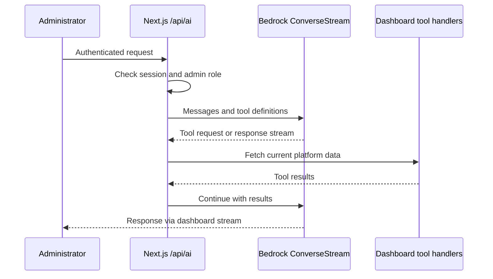
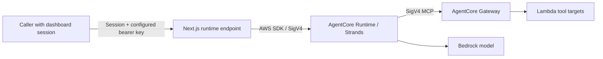

# AI Assistant Implementation Reference

Reconciled against repository source on 2026-10-26. Current architecture and
accepted scope remain in [architecture](../docs/architecture.md) and
[BASELINE](../docs/decisions/BASELINE.md). This reference does not establish
that optional AgentCore resources are deployed.

## Dashboard path

The dashboard's `/api/ai` route uses Bedrock Converse streaming directly. It
requires a NextAuth user session and an administrator. Its in-process tool loop
queries platform data through the handlers declared in that route; it does not
route dashboard chat through AgentCore Runtime.

`shared/nextjs-app/src/app/api/ai/route.ts` currently sets its model constant to
`global.anthropic.claude-sonnet-5`. This is a configured code default, not a
pricing or regional availability claim. A Terraform model variable does not
currently override this route constant.

## External runtime path

`/api/ai/runtime` is intended as a separate integration endpoint. Current
middleware matches `/api/ai/:path*` and requires a NextAuth session before the
handler runs. The handler additionally requires
`Authorization: Bearer <RUNTIME_API_KEY>` matching the configured secret.
A session alone is insufficient, and an external bearer-only caller is rejected
by middleware with 401. Missing key configuration returns 403 after the session
gate. Supporting external callers without a dashboard session is an outstanding
implementation issue. The server invokes AgentCore with its AWS SDK credentials
and passes the gateway URL in the runtime payload.

Configuration is `AWS_REGION`, `AGENTCORE_RUNTIME_ARN`, `AGENTCORE_GATEWAY_URL`
and the secret `RUNTIME_API_KEY`. Do not embed secret values in docs or logs.
`agent/agent.py` uses `BEDROCK_MODEL_ID`, defaulting to
`global.anthropic.claude-sonnet-5`. Gateway connection failure falls back to a
model response without tools; that response must not imply verified live data.

## Ownership and limitations

- AgentCore Runtime/Gateway/Memory and target helpers are not fully owned by
  current Terraform. Extending this area requires reconciliation with ADR-001;
  the helper scripts are existing gaps, not an alternative deployment standard.
- Gateway targets include ECS/EFS-oriented helpers left from the earlier
  container architecture. Current DevEnvs are EC2 with separate EBS volumes;
  tool names do not prove they support that topology.
- Memory, voice and Slack UI concepts in historical designs are not evidence of
  an enabled, production-verified feature. Check the specific source and runtime
  configuration before presenting them as available.
- User Bedrock budgets and admin assistant inference are separate call paths;
  do not infer assistant RBAC or spend attribution from the local CLI role alone.

## Code pointers and validation

| Concern | Source |
|---|---|
| Dashboard tool loop and admin auth | `shared/nextjs-app/src/app/api/ai/route.ts` |
| Runtime bearer-key gate | `shared/nextjs-app/src/app/api/ai/runtime/route.ts` |
| Session gate before runtime handler | `shared/nextjs-app/src/middleware.ts` |
| Runtime entry point / model / fallback | `agent/agent.py` |
| Gateway SigV4 transport | `agent/streamable_http_sigv4.py` |
| Existing target helpers and known gaps | `agent/CLAUDE.md`, `agent/lambda/` |

Local validation: dashboard typecheck/Vitest and Python source compilation.
Runtime invocation and Gateway behavior require separately configured live
resources. Documentation sync did not invoke or deploy them.
