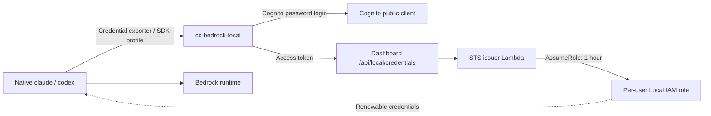

# User Authentication and Development Environment Security

Reconciled against repository source on 2026-10-26. Read
[BASELINE](../docs/decisions/BASELINE.md), [architecture](../docs/architecture.md)
and the [deployment guide](../docs/deployment-guide.md) for current requirements.
Historical ECS-container diagrams do not describe current per-user compute.

## Authentication and profiles

Accounts are administrator-created in Cognito; self-signup is disabled. The
Next.js dashboard uses NextAuth and its own `/login` form. Temporary-password
sign-in requires a new-password challenge. Forgot-password recovery either
re-sends a pending invitation or issues a reset code for a confirmed account.
Cognito Hosted UI is not the normal dashboard login path.

| Profile | User access |
|---|---|
| `governance` (default) | Dashboard and local Claude Code/Codex on the user's PC |
| `devenv` | Governance access plus per-user ARM64 EC2 with browser code-server |

The deprecated `governance_only` input overrides `deployment_mode`. A profile
change can remove DevEnv infrastructure and must be reviewed explicitly.

## Local credential path

`cc-bedrock-local setup` configures Claude's `awsCredentialExport`, Codex's
`amazon-bedrock-runtime` provider/profile and AWS `credential_process`.
Login caches a refresh token. The installer offers setup/login but does not
install the client binaries; a skipped prompt requires manual setup/login.
An inherited `AWS_BEARER_TOKEN_BEDROCK` can override governed role credentials.
Claude's cache Read deny and Codex's configured directory deny are limited
client protections, not universal isolation; custom Codex sandbox settings
require checking the setup warning and applying the deny manually.
Issued STS credentials last at most one hour due to role chaining and renew as
needed. Data records use lowercased email; role/resource names use the user's
canonical subdomain. Cognito UUIDs are not interchangeable with those keys.

Claude Code uses application inference profiles. Codex uses only the
`amazon-bedrock-runtime` Responses provider, with `global.openai.*` model
profiles; Responses usage is attributed by per-user role. Bedrock Mantle is
excluded. Kiro's IAM Identity Center subscription is outside token governance.

## Network and compute isolation

The dashboard is a Next.js Docker container on an EC2 Auto Scaling group behind
an internal ALB. DevEnv routing uses an internal NLB and nginx on ECS Fargate;
the user's development environment itself is EC2, not an ECS task or EFS mount.
Both public access paths enter through CloudFront VPC origins with origin
security-group restrictions. DevEnv nginx also validates the custom secret
header. Dashboard CloudFront sends the header, but its ALB listener has no
header-validation rule. There is no public compute IP or direct internet-facing
load balancer.

The VPC, subnets and Route 53 public zone are supplied/shared resources.
Terraform adds platform records and selected missing interface endpoints.
DLP is configurable per user as open/restricted/locked through network and IDE
controls. DNS Firewall associations apply to the VPC; they do not create a
separate per-instance DNS policy.

## IAM and budget enforcement

EC2 and Local users have separate per-user roles with a shared policy shape,
permission boundary and identity tags. The boundary is authored in Terraform
and includes account-scoped allowance plus a `DenyEscalation` floor. Extra IAM
permissions require administrator approval; UI validation and the boundary
must agree. Presence of a model name in a group does not enforce a model budget.

Invocation logs feed the usage tracker and DynamoDB. Claude and Codex count
against the same USD and normalized-token limits; independent applicable caps
can attach IAM denies. USD daily/weekly/monthly windows use UTC, while token
limits use KST. Exact normalization/rates are code/configuration in
`lambda/token-limit-enforcer.py` and `lambda/bedrock-usage-tracker.py`; this
reference deliberately does not publish unsupported price estimates.

CloudTrail management events support audit, separately from invocation-log
usage metering. Native Claude Code OTEL supplies productivity metrics and
scrubbed tool-event counts through collector/S3/rollup. It is not the billing
source, and Codex productivity rollup remains a follow-up.

## Persistent storage and recovery

The user's `/home/coder` lives on a separate encrypted GP3 data volume with
`DeleteOnTermination=false`. Stored `dataVolumeId` is authoritative; canonical
subdomain tags provide fail-closed rediscovery when records are unavailable.
Duplicate candidates or an unavailable matching AZ require operator resolution.

ADR-002 intends a replaceable ephemeral OS root, but runtime and Terraform
currently also retain the root volume (`DeleteOnTermination=false`). Inventory
both volumes before cleanup. Do not equate instance termination or Terraform
redeployment with deletion of persistent data, or promise that it backs up
Cognito, DynamoDB, S3 or encryption keys. Follow
[instance recovery](../docs/runbooks/instance-recovery.md) and
[destroy/redeploy](../docs/runbooks/full-teardown-redeploy.md).

## Code pointers

| Concern | Source |
|---|---|
| Dashboard auth and password recovery | `shared/nextjs-app/src/lib/auth.ts`, `shared/nextjs-app/src/app/api/auth/` |
| Session/access-token credential gate | `shared/nextjs-app/src/app/api/local/credentials/route.ts` |
| Local issuance and role identity | `lambda/sts-issuer.py`, `lambda/role_factory.py` |
| Data volume discovery and AZ matching | `shared/nextjs-app/src/lib/data-volume.ts` |
| Boundary / Cognito / secrets | `terraform/modules/security/main.tf` |
| Internal routing and origins | `terraform/modules/dashboard/main.tf`, `terraform/modules/ecs-devenv/main.tf` |
| Usage and budget implementation | `lambda/CLAUDE.md`, `docs/runbooks/codex-cost-budget-audit.md` |

The event-driven provisioner and AgentCore helpers have ownership/wiring gaps
recorded in scoped documentation. Source presence and dated deployment reports
alone do not establish that an optional feature is live.
